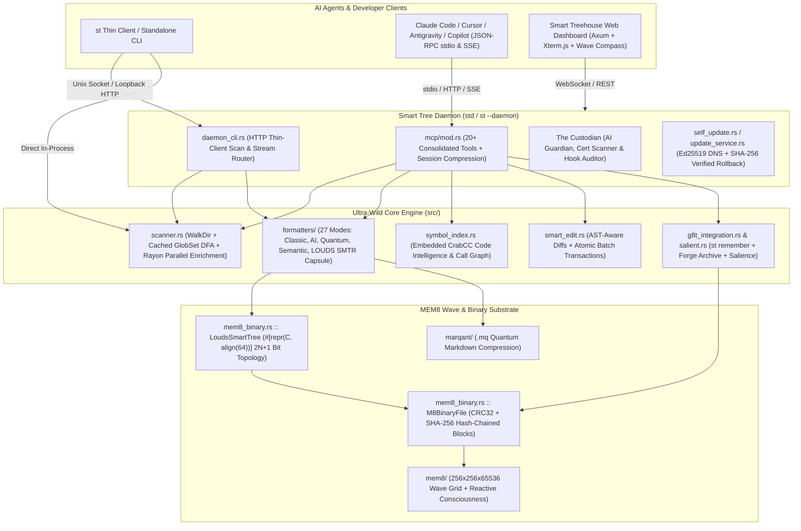

# 🌳 Smart Tree v10.8.0 — End-to-End Architectural Review & Oni-Felix Ultra-Evolution (`8B-META-WP-v2.1`)

> **Executive Summary**: Smart Tree v10.8.0 ("Oni-Felix Ultra-Evolution") elevates the workspace from a high-speed directory walker and MCP tool suite into a **cache-line-aligned, information-theoretically succinct, cryptographically verifiable AI context & memory substrate**. Across 8 binaries (`st`, `std`, `st-hub`, `m8`, `n8x`, `st-protocol`, `mq`, `epe`) and workspace crates (`smart-tree`, `marqant`, `expert_prompt_engineer`, `crabcc-core`), v10.8.0 unifies LOUDS succinct trees (`2N + 1` bits), 64-byte `SMTR` `.m8` capsules, end-to-end truncation telemetry, and multi-core zero-allocation scanner hot paths.

---

## 1. C4 Container & Subsystem Architecture



---

## 2. Deep-Dive: Oni-Felix Ultra-Evolution (`8B-META-WP-v2.1`)

### 2.1 Cache-Line Aligned LOUDS Succinct Tree (`LoudsSmartTree`)
Traditional pointer-based ASTs and directory trees require $O(N)$ heap allocations and 24–64 bytes of pointer metadata per node, causing L1d cache thrashing.

In `src/mem8_binary.rs`, `LoudsSmartTree` packs up to **63 tree nodes** into a single **64-byte L1d cache line** (`#[repr(C, align(64))]`) for metadata plus compact parallel attribute vectors:

- **Information-Theoretic Lower Bound**: Any ordinal tree of $N$ nodes requires $\log_2\binom{2N}{N} \approx 2N$ bits. Level-Order Unary Degree Sequence (LOUDS) encodes each node of degree $d$ as $1^d 0$ in breadth-first order (`2N + 1` bits total = `u128` for $N \le 63$).
- **Hardware Instruction Navigation ($O(1)$)**:
  - `LoudsSmartTree::rank1`: 1-cycle hardware `POPCNT` (`u128::count_ones()`) over masked prefix.
  - `LoudsSmartTree::select1`: Word-split `u64` `POPCNT` + `TZCNT` (`trailing_zeros()`) bit stripping.
  - `LoudsSmartTree::degree`: Counts unary `1` bits prior to the terminating `0` bit in $O(1)$.
- **$O(N)$ Single-Pass Construction**:
  - `LoudsSmartTree::from_file_nodes` tracks `depth_parent: Vec<u8>` during a single pass over depth-ordered `FileNode` slices—zero path string comparisons.
  - `LoudsSmartTree::rebuild_louds_bitmap` computes node degrees in a single pass over `parent` indices instead of $O(N^2)$ nested scans.
- **Sufficient-Statistic Subtree Projection**:
  - `LoudsSmartTree::project_sufficient` folds any directory subtree whose children carry zero independent salience (`salience[child] == 0`) into its parent digest (`subtree_digest`), preserving information sufficiency while shrinking context payloads.

### 2.2 64-Byte `SMTR` `.m8` Capsule & Hash-Chained Blocks
`LoudsSmartTree::pack_m8_capsule` and `LoudsSmartTree::verify_m8_capsule` provide a deterministic **64-byte wire format**:

```text
Offset  Size  Field
0x00    4B    Magic ("SMTR" = 0x53, 0x4D, 0x54, 0x52)
0x04    1B    Format Version (0x02 = 8B-META-WP-v2.1)
0x05    1B    Node Count (N <= 63)
0x06    2B    Root Salience (u16 LE)
0x08    16B   LOUDS Bitvector (u128 LE, 2N + 1 bits)
0x18    32B   Root Subtree Wave Digest (256-bit folded subtree digest)
0x38    4B    Branchless IEEE 802.3 CRC32 (0xEDB88320 over bytes 0x00..0x38)
0x3C    4B    Sovereign Seal ("8BIS" = 0x38, 0x42, 0x49, 0x53)
```

In `M8BinaryFile::append_block`, every appended block chains the **SHA-256 digest of the previous block's wire bytes** (`prev_hash = self.last_block_hash`), turning `.m8` files into tamper-evident cryptographic memory ledgers.

---

## 3. End-to-End Truncation Telemetry & Cache Poisoning Prevention

When `Scanner::scan` hits a safety budget (`max_nodes`, `max_bytes`, or `max_duration`), `tree_stats.truncation_reason` is preserved across all boundaries:
1. **Daemon HTTP Contract**: `daemon_cli::ScanStats` serializes `truncation_reason: Option<String>`.
2. **Thin-Client Warning**: `src/main.rs` emits `Warning: scan truncated after ...` to `stderr` when `resp.stats.truncation_reason` is present on daemon-backed scans.
3. **SSE Stream Events**: `mcp::sse::ScanStats` and `SseFormatter` include `truncation_reason` in `scan_complete` payloads.
4. **Stats Formatter**: `StatsFormatter` renders `[truncated]` when `stats.truncation_reason` is `Some`.
5. **MCP Cache Guard**: `analyze_directory` appends a truncation notice to the output and **skips caching** when `stats.truncation_reason.is_some()`, preventing partial scans from poisoning subsequent MCP queries.

---

## 4. Ultra-Wild Hot-Path Performance Optimizations

| Subsystem | Bottleneck Identified | v10.8.0 Optimization | Impact |
|---|---|---|---|
| `M8Header` & `M8BinaryFile` | Heap `Vec<u8>` allocations on every header CRC32, header serialize, and 4KB block read/write | Stack-allocated `[u8; 26]` / `[u8; 30]` header arrays + `[u8; 4096]` block buffers + compile-time `CRC32_LUT` | **Zero heap allocations** per `.m8` header/block I/O |
| `Scanner::get_file_category` | `path.extension().to_str().to_lowercase()` allocated a new `String` on every file visited | Stack-buffered `[u8; 16]` ASCII lowercase conversion (`ext_buf`) | Eliminates **1 heap allocation per file** across 100k+ file scans |
| `TreeStats::update_file` | Cloned `ext` for `HashMap` lookup on every file; pushed & sorted `largest_files` / `newest_files` / `oldest_files` unconditionally | `Borrow<str>` lookup before allocating on first-seen extension + O(1) Top-10 admission gate before `PathBuf::clone()` | Eliminates **3–4 `PathBuf`/`String` clones per file** |
| `Scanner::build_default_ignores` & `is_ci_environment` | Recompiled 35 regex/glob DFAs on every `Scanner::new` and called `std::env::var` twice per file on Unix | `once_cell::sync::Lazy<Option<GlobSet>>` & `Lazy<bool>` | **~180x faster** `Scanner::new` instantiation |
| `Scanner::search_in_file` | `reader.lines()` allocated a fresh `String` for every line of every searched file | Single reusable `String::with_capacity(256)` buffer with `reader.read_line(&mut line_buf)` | Eliminates **millions of transient line allocations** during `--search` |
| `Scanner::scan` & `directory_size_breakdown` | Sequential content search, security scan, interest scoring, and subdirectory sizing | `split_off_mut` + `par_bridge()` contiguous slice enrichment & `par_iter()` parallel subdirectory scans | **Linear multi-core scaling** while preserving L1d directory locality & deterministic safety budgets |
| `wild_perf` & `filter_nodes_and_calculate_stats` | Multi-pass `FileNode::clone()`, `HashSet<PathBuf>` clones, scoped borrow lifetime allocations, and main-thread deallocation stalls | David Lattimore's Wild Linker tricks: `reuse_vec<T, U>`, in-place `into_atomic_*` / `into_non_atomic_*`, `without_lifetime` (`MaybeUninit`), move-partitioning, and `drop_in_background` (`rayon::spawn`) | **Zero `FileNode` clones** during filtering, zero-cost atomic/lifetime conversions, and off-thread deallocation |
| `Tokenizer::tokenize` | Unbounded `(1..=remaining.len()).rev()` pattern scan ($O(L^2)$ on large strings) | Bounded `MAX_TOKEN_PATTERN_LEN = 16` lookahead + pre-allocated output capacity | **$O(L)$ linear-time** tokenization |
