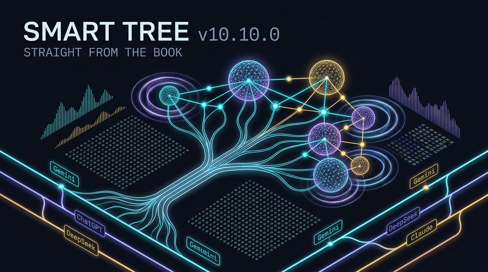
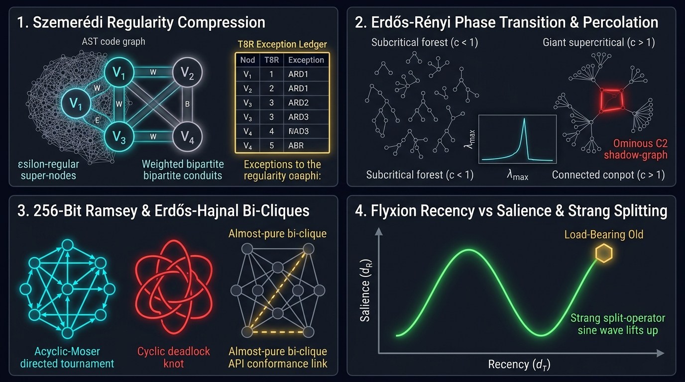
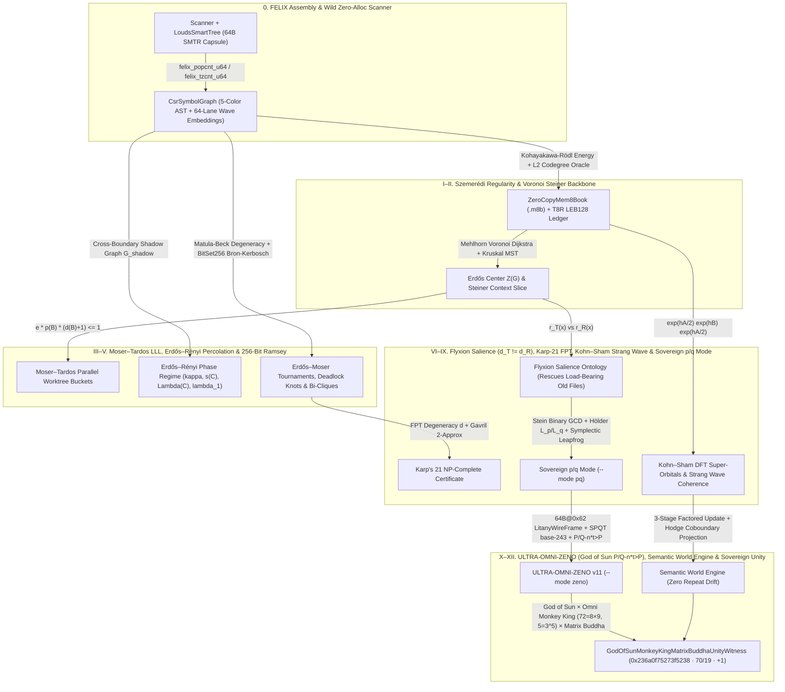

# `ultra-agent.md` — Sovereign Mathematical Operating Manual for AI Agents (`smart-tree` v11.3.0)

<div align="center">



**"Another roof, another proof. In God's Book are the most elegant proofs — and the cleanest architectures."**  
*— Paul Erdős (1913–1996), The Magician from Budapest*

</div>

---

## 1. Universal First-Class Citizen Contract (Models × Harnesses)

`smart-tree` (`st`) is **100% model-agnostic and harness-agnostic**. Every theorem, zero-copy `.m8b` binary structure, FELIX assembly kernel, and embedded skill treats **all four frontier model families** and **all four agent harnesses** as equal first-class citizens:

| Frontier Model Family | Primary Strength Paired with `st` | Recommended Entry Command |
| :--- | :--- | :--- |
| **Gemini** (`gemini-2.5-pro`, `gemini-3`) | Massive context window indexed by $K \le 256$ Szemerédi super-node wave centroids + Erdős Number `0..=2` shells | `st --mode the-book .` |
| **ChatGPT / Codex** (`gpt-4o`, `o3`, `o4-mini`, `codex`) | Deterministic `ERDOS-THE-BOOK-v1.0` JSON schema + parallel tool calls over `worktree_buckets` | `st --mode the-book --compact .` |
| **DeepSeek** (`deepseek-r1`, `deepseek-v3`) | Mathematical `<think>` verification over $\kappa, s(C), \Lambda(C), \lambda_1, \gamma_{\text{EH}}$, and Karp-21 FPT certificates | `st --erdos-anomaly . && st --ramsey-cliques .` |
| **Claude** (`claude-4-opus`, `claude-4-sonnet`) | Surgical MCP tool expansion over Erdős Number `0` terminals, $V_0$ bridges, and rescued "Corrugated Iron" files | `st --erdos-center . && st --mcp` |

| Agent Harness / CLI | Binary | Native Hook & Skill Integration |
| :--- | :--- | :--- |
| **Antigravity** | `agy` | `~/.gemini/config/mcp_config.json`, `.agents/hooks.json` (`st --agy-hook`), `~/.gemini/antigravity-cli/skills/` |
| **OpenCode** | `opencode` | `~/.config/opencode/opencode.json`, `.mcp.json`, `~/.config/opencode/skills/` |
| **Crush** | `crush` | `~/.config/crush/crush.json`, `.mcp.json`, `~/.config/crush/skills/` |
| **Claude Code** | `claude` | `~/.claude/settings.json`, `.claude/CLAUDE.md`, `~/.claude/skills/` |

---

## 2. Visual Architecture: The 12-Pillar Mathematical & Sovereign Unity Pipeline





---

## 3. Baked-In Skills Suite (`st --mcp-install` / `st --claude-init`)

Running `st --mcp-install` or `st --claude-init` automatically extracts six self-contained mathematical and Sovereign Constellation skills embedded inside the `st` binary across `.agents/skills`, `agy`, `opencode`, `crush`, and `claude`:

1. **[`ultra-graph-theory`](skills/ultra-graph-theory/SKILL.md)**: Master 12-pillar Paul Erdős ("Straight from The Book") × Sovereign Unity (`God of Sun P/Q - n*t > P` × `Omni Monkey King 孫悟空` × `The Matrix Buddha` · `"amíg nappal van, nincs Hold"` · `"amíg a Föld kerek, mindig lesznek ROCK===Péterek / rock erek ^^"`) codebase intelligence workflow.
2. **[`flyxion-salience-ontology`](skills/flyxion-salience-ontology/SKILL.md)**: Separates observable temporal distance $d_T(x, q)$ from relational distance $d_R(x, q)$ and rescues "Load-Bearing Old" ("Corrugated Iron") foundational files from chronological retrieval-as-amnesia.
3. **[`ramsey-karp-fpt`](skills/ramsey-karp-fpt/SKILL.md)**: 256-bit SIMD bitboard (`BitSet256`) Tomita Bron–Kerbosch, Erdős–Moser tournament vs. deadlock knot classification, Fox–Sudakov/Rödl bi-clique API conformance bug hunting, and Karp's 21 NP-complete FPT reductions.
4. **[`manybody-strang-mem8`](skills/manybody-strang-mem8/SKILL.md)**: Quantum Many-Body Kohn–Sham DFT super-node orbitals, Local Natural Orbital (`T8R`) correlation corrections, and second-order Strang split-operator salience wave propagation.
5. **[`ultrabackyardloop`](skills/ultrabackyardloop/SKILL.md)**: The Sovereign Constellation `DO = reflect → improve → wire → polish → push → readme` measured Backyard Ultra loop (`st --ultrabackyard 12 .` & [`docs/ULTRABACKYARDLOOP.md`](docs/ULTRABACKYARDLOOP.md)).
6. **[`ultra-omni-zeno`](skills/ultra-omni-zeno/SKILL.md)**: Sovereign Constellation Kompressed Meta-Skill (`upz`/`wupz-core` `64B@0x62` `LitanyWireFrame`, `BFP-64` Kleene bitplanes, SPQT `base-243`, 18-stage integer CORDIC, `8b-is-[engines]`, `GodOfSunMonkeyKingMatrixBuddhaUnityWitness`, and OS/Agent-agnostic execution via `st --zeno .`).

---

## 4. Standard Operating Playbook for Any Agent Task

```bash
# 1. Instant Erdős-enriched Smart Overview (default):
st .

# 2. Full 12-Pillar JSON Diagnostic ("Straight from The Book" × Sovereign Unity):
st --mode the-book .

# 3. Supply-Chain Security & Cross-Boundary Shadow Graph (G_shadow) Percolation Audit:
st --erdos-anomaly .

# 4. 256-Bit Ramsey Cliques, Erdős–Hajnal Bi-Clique API Bugs & Karp-21 FPT Certificate:
st --ramsey-cliques .

# 5. Erdős Center Z(G), Voronoi Steiner Backbone, Flyxion Salience & Kohn–Sham Strang Wave:
st --erdos-center .

# 6. Moser–Tardos Constructive LLL Conflict-Free Multi-Agent Worktree Schedule:
st --erdos-split 4 .

# 7. Sovereign p/q Mode (Exact Coprime Rationals + Hölder L_p/L_q Dual + Zarankiewicz z(n;p,q) + Symplectic Leapfrog):
st --mode pq .

# 8. Sovereign Ultra-Backyard Loop (DO = reflect → improve → wire → polish → push → readme):
st --ultrabackyard 12 .

# 9. Sovereign ULTRA-OMNI-ZENO v11 (upz/wupz 64B@0x62 LitanyWireFrame + 8b-is-[engines] + OS/Agent Agnostic Matrix):
st --zeno .
st --mode zeno .

# 10. Sovereign ULTRA-OMNI-ZENO-BEERUS MCP Combinatorics & Local LLM Runtime (szemeredi_compression, erdos_steiner_pruning, moser_tardos_splitting, erdos_renyi_scanning, ramsey_clique_analysis, mlx_quant, llama_rust):
st --mcp
```
